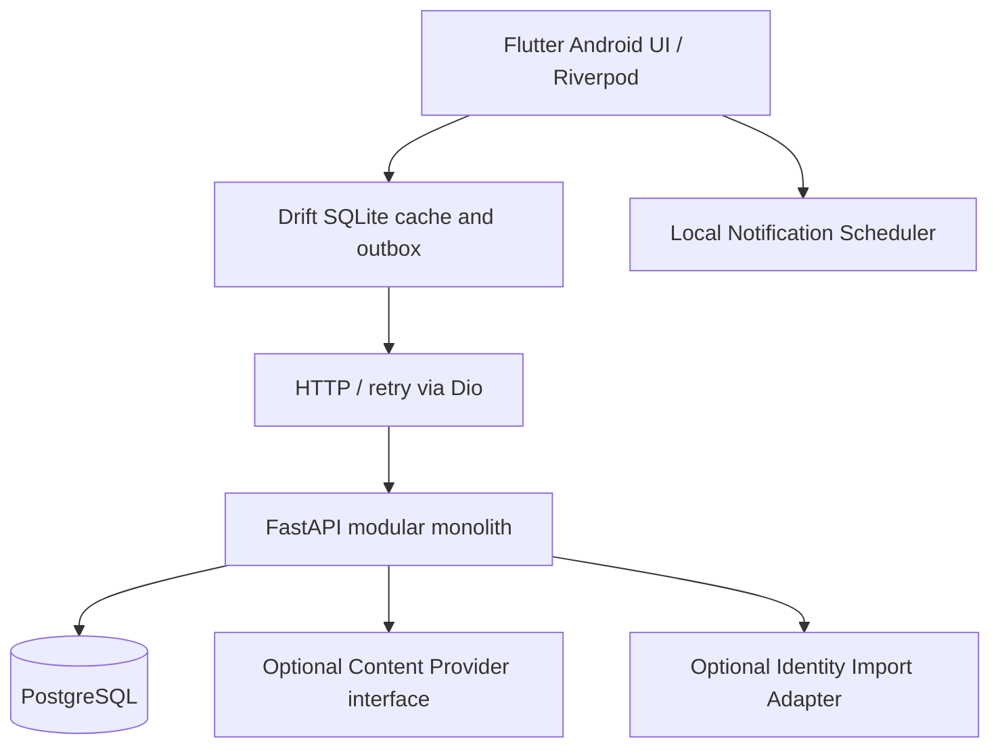

# 02 | Architecture and repo structure

## Choice: modular monolith, not microservices



The app uses a layered architecture without a separate repository abstraction for each trivial DB access. Python backend modules are features within **one deployment** and one DB. No Docker orchestration beyond Compose initially.

## Repository layout (proposed)

```text
muhasaba/
  AGENTS.md
  docs/                  # these blueprint files
  backend/
    pyproject.toml
    alembic.ini
    alembic/versions/
    app/
      main.py
      core/               # config, security, DB sessions, exceptions
      modules/
        auth/             # API, service, models, schemas
        accounts/         # user + external identity links
        catalog/          # published activities and official adhkar library, admin review
        journal/          # date states, item counters, undo, day snapshots
        fasting/          # date eligibility and plans
        reports/          # on-demand derived summaries
        personal_content/ # private user items and effective-dated group plans
        content/          # video links; no external API required initially
      tests/
  mobile/
    lib/
      core/               # theme, dates/timezones, API client, local DB
      features/
        auth/
        daily/
        adhkar/
        fasting/
        reminders/
        reports/
        settings/
  infra/
    compose.yml
    .env.example
```

## Scope boundaries

- **Mobile** owns presentation, instantaneous counters and on-device notification scheduling. It does not determine the canonical activity weights.
- **API** owns verified auth, authorization, catalog publication, eligibility and score recalculation, and user-specific journal persistence.
- **Postgres** owns durable canonical histories and uniqueness. **Drift** owns offline local state, cache and an outbox of unsent writes.
- **Content Provider** maps approved official videos (`youtube_video_id`, `source_url`) to catalog activities. Initial implementation is a curated DB-backed list; an official remote API adapter only after contracts/permission are verified.
- **External Identity Import Adapter** initially means a documented contract, schema and no active connector. Later implement one provider using least privileges.

## Data flow: user completes an individual dhikr

1. UI reads `(activity_code, item_code, local_date, target_count, completed_count)` from local Drift.
2. User increments/toggles count; a Drift transaction updates value and outbox operation with `client_mutation_id`.
3. Pure score function recalculates `ADHKAR_SET` completion. UI updates parent card and global percent.
4. Sync sends idempotent mutation with `expected_version` to API.
5. FastAPI validates auth, activity set, date, target and count; commits in transaction, recomputes canonical daily score when returned.
6. Conflicting version -> 409; client preserves pending change and offers resolution; no silent overwrite.

## Operational simplicity

- No event bus, Kafka, RabbitMQ, Redis, Celery, WebSocket or third-party analytics in MVP. Admin catalog changes via minimal protected FastAPI endpoints; a rich CMS frontend is deferred.
- Alembic migration files are reviewed and applied in CI/staging; never `create_all()` as production migration strategy.
- PostgreSQL backups daily plus tested restore, HTTPS reverse proxy, environment-based secrets, structured logs without private dhikr texts/counters.
- Dependable single primary device editing first; a separate multi-device sync RFC only when genuinely needed.

## Scope change policy

New tables and integrations require clear user journey, schema impact, security implications and acceptance tests. New API routes only when used by an actual screen/feature or essential administration.

## v1.3 boundary: official catalog, user plan and daily snapshot

- **Official Content Library**: global admin-authored and reviewed source content. Admin edits are drafts until published. Published releases and bound activity item texts/targets are immutable to preserve history.
- **Personal content**: user-owned private adhkar/dua, never available to other users or used as an official verified text. The user can hide default items and add personal ones *to their own daily group plan*.
- **Dual resolution**: scoring membership comes exclusively from all official `adhkar_items` marked score-eligible in the day's immutable catalog release. Personal `user_group_plans` only change display visibility/order and the user-added private tracking list. On first day edit freeze official score-bearing snapshots and separate custom track-only snapshots; hiding a default does not remove its score-bearing row.
- **Scoring**: pure Python function shared by API tests with equivalent Flutter fixtures. The fixed main-card weight is apportioned only across verified official score-eligible item snapshots. Custom completion, visibility and ordering have no effect. A scored group without at least one official scoring item is a publication error, not an auto-complete or zero-denominator trick.
- **Write API**: UI `toggle` maps to `PUT completed=true/false`, never a non-idempotent backend `/toggle`. Flutter optimistic update/outbox uses explicit final desired state and row versions.
- Admin management starts as protected endpoints available through OpenAPI, not an extra web frontend/second backend. If actual editors need a visual UI later, build a thin admin interface against the same API.