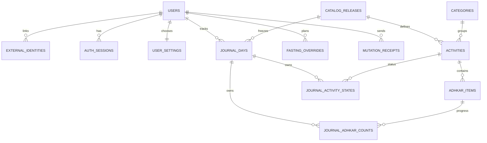

# 03 | PostgreSQL Database Design v1.1

## Goals

Canonical UUID user IDs regardless of source, versioned catalog, separate activity points from adhkar repetition counters, planned fast days and seasonal Ramadan, no excessive sync/event tables. A day's score is **derived**, not user-editable.

## ERD (logical)

## Table dictionary (MVP)

### 1. `users` (canonical identities)

- `id UUID PRIMARY KEY`
- `email_normalized VARCHAR(320) NULL UNIQUE` (import may not include email)
- `password_hash TEXT NULL` (NULL for imported users until account activation or external login)
- `registration_source VARCHAR(12) NOT NULL` with CHECK `NATIVE`/`IMPORTED`
- `timezone VARCHAR(64) NOT NULL DEFAULT 'Africa/Cairo'`
- `locale VARCHAR(16) NOT NULL DEFAULT 'ar-EG'`
- `region_key VARCHAR(32) NOT NULL DEFAULT 'EG'` (Ramadan configuration)
- `tracking_start_date DATE NOT NULL`
- `email_verified_at TIMESTAMPTZ NULL`, `created_at TIMESTAMPTZ`, `updated_at TIMESTAMPTZ`, `deleted_at TIMESTAMPTZ NULL`

**Rule:** `registration_source` records origin, **not** present authentication method. An initially native user can later gain a linked external identity.

### 2. `external_identities` (created now, no active import connector)

- `id UUID PRIMARY KEY`, `user_id UUID NOT NULL REFERENCES users(id)`
- `source_system VARCHAR(60) NOT NULL` (e.g. partnerA, not internal host name)
- `external_subject VARCHAR(255) NOT NULL`
- `link_status VARCHAR(12) NOT NULL CHECK IN ('PENDING','VERIFIED','REVOKED')`
- `verified_at TIMESTAMPTZ NULL`, `created_at TIMESTAMPTZ NOT NULL`
- `UNIQUE(source_system, external_subject)` and `INDEX(user_id)`.

**No direct DB credential, password or password hash of other systems is copied here.** Never authorize by external ID alone. An account merge or link requires proof of control for both identities or approved authenticated admin migration.

### 3. `auth_sessions`

`id UUID PK`, `user_id UUID FK`, `refresh_token_hash TEXT NOT NULL`, `expires_at`, `revoked_at NULL`, `created_at`, `last_seen_at NULL` all `TIMESTAMPTZ`. Short-lived access tokens, rotating refresh tokens, store hashed refresh tokens, device secure storage.

### 4. `user_settings`

- `user_id UUID PRIMARY KEY REFERENCES users(id)`
- `theme VARCHAR(12) DEFAULT 'DARK'`
- `reminder_settings JSONB NOT NULL DEFAULT '{}'` (portable preference template; device still owns scheduled alarms)
- `quiet_hours JSONB NULL`, `updated_at TIMESTAMPTZ`.

Only allow validated JSON shapes through the API; no arbitrary free-form clinical/faith annotations.

### 5. `categories`

`id UUID PK`, `code VARCHAR(30) UNIQUE NOT NULL`, `title_ar VARCHAR(100)`, `sort_order SMALLINT UNIQUE`. Seed eight reference categories. Stable codes independent of Arabic titles.

### 6. `catalog_releases`

`id UUID PK`, `code VARCHAR(50) UNIQUE`, `effective_from DATE UNIQUE NOT NULL`, `status VARCHAR(12) CHECK IN ('DRAFT','PUBLISHED')`, `created_at`, `published_at NULL`. Published release and included definitions are immutable. New weights/text require new release; same fixed `activity.code` reused across releases.

### 7. `activities`

- `id UUID PRIMARY KEY`, `catalog_release_id UUID REFERENCES catalog_releases`, `category_id UUID REFERENCES categories`
- `code VARCHAR(80) NOT NULL` (stable across releases)
- `title_ar VARCHAR(200) NOT NULL`, `sort_order SMALLINT NOT NULL`
- `points SMALLINT NOT NULL CHECK (points>=0)` (e.g., 2, **not** how many times to recite)
- `kind VARCHAR(20) CHECK IN ('TOGGLE','ADHKAR_SET','FASTING')`
- `schedule_kind VARCHAR(24) CHECK IN ('DAILY','WEEKLY_FAST','FASTING_DYNAMIC')` for fasting use `FASTING_DYNAMIC`
- `is_active BOOLEAN DEFAULT TRUE`, `description_ar TEXT NULL`, `show_details BOOLEAN NOT NULL`
- `UNIQUE(catalog_release_id, code)` and `UNIQUE(catalog_release_id, category_id, sort_order)`.

34 initial activity codes from `seed/catalog_reference_34.csv` (source-derived reference, **not** a validated published catalog). Every `?` card with verified textual content can be `ADHKAR_SET`; if content is still missing, do not falsely mark it complete or show placeholder as an authentic dhikr.

### 8. `adhkar_items` (immutable group bindings in catalog releases)

- `id UUID PK`, `activity_id UUID REFERENCES activities(id) ON DELETE RESTRICT`, `library_entry_id UUID NULL REFERENCES library_entries(id)`
- `code VARCHAR(90) NOT NULL`, `text_ar TEXT NOT NULL`, `sort_order SMALLINT NOT NULL`
- `target_count SMALLINT NOT NULL CHECK (target_count>=1 AND target_count<=1000)`
- `source_name TEXT NULL`, `source_url TEXT NULL`, `license_notes TEXT NULL`, `review_status VARCHAR(12) CHECK IN ('DRAFT','VERIFIED')`
- `UNIQUE(activity_id,code)`, `UNIQUE(activity_id,sort_order)`.

Complete texts should be approved, attributed and checked with tashkeel; user images confirm existence/count UI but do not establish licenses or the full canonical collection.

### 9. `journal_days`

`id UUID PK`, `user_id UUID REFERENCES users`, `local_date DATE NOT NULL`, `catalog_release_id UUID REFERENCES catalog_releases`, `timezone_at_creation VARCHAR(64)`, `created_at`, `updated_at`, `UNIQUE(user_id,local_date)`.

Only created after an edit. Reporting can derive 0 completion for a past day with no row, using dated release and registered tracking start. A created day pins the release for history.

### 10. `journal_activity_states`

- `id UUID PK`, `journal_day_id UUID FK journal_days`, `activity_id UUID FK activities`
- `state VARCHAR(12) NOT NULL CHECK IN ('PENDING','COMPLETED','EXCLUDED')`
- `row_version INTEGER NOT NULL DEFAULT 1`, `updated_at TIMESTAMPTZ`
- `UNIQUE(journal_day_id,activity_id)`.

**Rules:** for a normal `TOGGLE` or `FASTING`, COMPLETED records completion. For an `ADHKAR_SET`, only EXCLUDED and PENDING are allowed; COMPLETED is **derived from individual adhkar counters** and is never stored on the parent. The absence of a row means initial PENDING with version 0. Once a row has been created, keep explicit PENDING rows when undoing so `row_version` remains monotonic. For a detailed collection, parent EXCLUDED suppresses score regardless of saved item counts.

### 11. `journal_adhkar_counts` (resolved item snapshot + current count)

Each row refers to **one item actually in the user's group plan for that local journal day**, whether official or personal. Instead of polymorphic FK without integrity, use one of two nullable FKs:

- `id UUID PRIMARY KEY`, `journal_day_id UUID REFERENCES journal_days(id)`
- `activity_id UUID REFERENCES activities(id)` (must be in the day's pinned release)
- `adhkar_item_id UUID NULL REFERENCES adhkar_items(id)` for an official item
- `user_custom_item_id UUID NULL REFERENCES user_custom_items(id)` for a personal item
- `item_code_snapshot VARCHAR(90) NOT NULL`, `text_ar_snapshot TEXT NOT NULL`, `target_count_snapshot SMALLINT NOT NULL CHECK (target_count_snapshot BETWEEN 1 AND 1000)`
- `completed_count SMALLINT NOT NULL DEFAULT 0 CHECK(completed_count>=0)`; service validates `<= target_count_snapshot`
- `row_version INT NOT NULL DEFAULT 1`, `updated_at TIMESTAMPTZ`, `sort_order SMALLINT NOT NULL`
- `CHECK (num_nonnulls(adhkar_item_id, user_custom_item_id)=1)`; unique indexes scoped to `(journal_day_id, activity_id, adhkar_item_id)` for official and `(journal_day_id, activity_id, user_custom_item_id)` for personal, with `WHERE ... IS NOT NULL`.

On first edit to that day's group, atomically snapshot every official score-eligible item (including hidden defaults and zero counts) and separately any personal tracking items. Scoring membership is pinned by official catalog release, **not** the effective visible user plan. A day without edits reads the official release; first edit materializes it. Deletion/archiving never destroys referenced history. Include official/personal and `is_score_eligible` in API responses.

Compute derived group fraction ONLY over immutable **official score-eligible** `journal_adhkar_counts` snapshots, each with an equal share. Personal snapshots are tracked but excluded from parent score and denominator; `hidden_default_codes` is UI-only. Parent COMPLETED is derived from official entries; a `TOGGLE` undo stores explicit PENDING. A scored ADHKAR_SET with no verified official scoring rows must fail catalog publication (configuration error), never 0/0 or score from private entries.

### 12. `fasting_overrides`

- `id UUID PK`, `user_id UUID FK users`, `local_date DATE NOT NULL`
- `mode VARCHAR(8) CHECK IN ('DEFAULT','ADD','SKIP')`
- `fast_type VARCHAR(16) NULL CHECK IN ('VOLUNTARY','MAKEUP','OTHER')` (optional; RAMADAN and SUNNAH are *computed* from date/calendar)
- `row_version INTEGER NOT NULL DEFAULT 1`, `created_at`, `updated_at`, `UNIQUE(user_id,local_date)`.

`ADD` makes a normally unplanned day eligible. `SKIP` removes fasting from score denominator without needing a reason. `DEFAULT` restores the computed schedule. Keep a DEFAULT row once written so concurrency version does not reset. Future-day planning permitted, future-day completion prohibited.

### 13. `calendar_periods`

`id UUID PK`, `region_key VARCHAR(32)`, `period_kind VARCHAR(20)` (=RAMADAN), `start_date DATE`, `end_date DATE`, `confirmation_status VARCHAR(12)` (`PROVISIONAL`/`CONFIRMED`), `source_url TEXT NULL`, `updated_at`, `UNIQUE(region_key,period_kind,start_date)`, CHECK `end_date>=start_date`.

Only **CONFIRMED** periods automatically enable Ramadan fasting. For missing region/unknown dates prompt user to configure/confirm; never hard-code 30 days globally.

### 14. `mutation_receipts`

`id UUID PK` = client mutation UUID, `user_id UUID FK`, `payload_hash CHAR(64)`, `result_json JSONB`, `created_at TIMESTAMPTZ`, `UNIQUE(user_id,id)`; replay returns recorded result, same ID/different payload returns 409. Retention/cleanup reviewed, not required as a separate background service initially.

## Deferred table

`content_resources(id,activity_code,kind,provider,external_id,source_url,title_ar,review_status,created_at)` for official video links / article references. Introduce in feature migration when content functionality is approved, not PR-00.

## Critical indexes and relationships

- `journal_days(user_id,local_date)` unique: primary date lookup.
- `journal_activity_states(journal_day_id,activity_id)` unique; `journal_adhkar_counts` partial unique indexes per day/activity/official item or user custom item.
- `fasting_overrides(user_id,local_date)` unique, `external_identities(source_system,external_subject)` unique.
- `adhkar_items(activity_id,sort_order)` for modal ordering; `user_group_plans(user_id, activity_code, effective_from DESC)` for historical plan resolution.
- `users.email_normalized` unique when present. Normalize and verify email; never merge external identities by email-only equality.
- Enforce by service and integration tests: state/activity and count/item belong to same catalog release as `journal_days`.

## On-device SQLite via Drift

Minimum: `cached_catalogs`, `cached_activities`, `cached_adhkar_items`, `local_days`, `local_activity_states`, `local_adhkar_counts`, `local_user_custom_items`, `local_user_group_plans`, `local_fasting_overrides`, `sync_outbox`, `local_reminder_preferences`. `sync_outbox` contains `mutation_id`, operation_kind, date, item code/activity code, payload, expected_version, status and retries. User switching must purge/separate local journal per canonical user ID.

## Migration order

1. Core users and auth settings.
2. Catalog release/category/activity and adhkar content.
3. Journal/day/activity/adhkar states.
4. Fasting overrides and calendar periods.
5. Idempotency receipts.
6. External import adapter activation in later PR (schema exists), content resources only when used.

All migrations via Alembic, reviewed upgrades/downgrades; never use development `create_all` against production.

## v1.3: Official Library and personal customization (additional minimum schema)

### `library_entries` (ADMIN-owned content only)

- `id UUID PK`, `code VARCHAR(100) UNIQUE NOT NULL`, `type VARCHAR(8) CHECK IN ('DHIKR','DUA')`, `title_ar TEXT`, `text_ar TEXT NOT NULL`, `default_target_count SMALLINT CHECK BETWEEN 1 AND 1000`
- `source_name TEXT NULL`, `source_url TEXT NULL`, `license_notes TEXT NULL`, `review_status VARCHAR(12) CHECK IN ('DRAFT','VERIFIED')`, `status VARCHAR(12) CHECK IN ('DRAFT','ACTIVE','ARCHIVED')`
- `created_by_admin UUID FK users`, `created_at`, `updated_at`, `archived_at NULL`.

The library item is a **working editorial source**. Publishing a new `catalog_release` copies approved entry details into immutable `adhkar_items` (including source, target and text). Admin edit/archive does not rewrite historical release rows. An item can be reused in more than one group with distinct group order or repetition target if reviewed.

### `user_custom_items` (private text, no public publishing)

- `id UUID PK`, `user_id UUID FK users NOT NULL`, `type VARCHAR(8) CHECK IN ('DHIKR','DUA')`, `title_ar TEXT NULL`, `text_ar TEXT NOT NULL`, `target_count SMALLINT CHECK BETWEEN 1 AND 1000`, `created_at`, `archived_at NULL`, `updated_at`.
- An item is linked to groups through `user_group_plans` (below), so it can be reused within its owner's plan. Ownership is checked on **every** API operation. Edits affecting active journal history produce a new revision/item ID or apply prospectively; daily text and count are frozen in the snapshot.

### `user_group_plans` (effective-dated personal group configuration)

- `id UUID PK`, `user_id UUID FK users`, `activity_code VARCHAR(80)`, `effective_from DATE NOT NULL`, `hidden_default_codes JSONB NOT NULL DEFAULT '[]'`, `custom_items JSONB NOT NULL DEFAULT '[]'`, `created_at TIMESTAMPTZ`, `created_by_user UUID FK users`.
- `custom_items` is a **validated small ordered array** of `{customItemId, sortOrder}`. All referenced items must belong to the same user, non-archived on effective date, with unique IDs. Hidden official codes must exist in a selected catalog/group. No arbitrary JSON accepted at API boundaries.
- `UNIQUE(user_id, activity_code, effective_from)`. Published effective versions are immutable; when user changes their group plan, create the next effective-dated revision (allow editing a not-yet-active future version by replacing it with an optimistic-version guard). Historical lookup picks the latest valid plan effective on or before the date.
- Not every user needs a plan row: absent plan means defaults unchanged. Store no needless per-user copies of the official default set.

### Role and access policy

- Add `users.role` (`USER` or `ADMIN`; default `USER`) or existing equivalent RBAC claim. Admin can create/review/archive official content and publish catalog releases; ordinary users cannot call these endpoints.
- Ordinary users can CRUD only their own custom items and group plans. A custom item never becomes official automatically and does not leak via public catalog endpoints.
- `journal_days` plus count snapshots continue to use the existing canonical `user_id`. `external_identities` integration does not alter permissions for custom content.

### Historical and score invariants

- Parent group points are **fixed by the published catalog**; only official published score-eligible entries determine the weighted distribution. For 2 points and 5 official items, each is worth up to 0.4 points. Hide 2, add 1 private: score remains over the original 5 official items, personal item worth zero.
- A scored ADHKAR_SET cannot publish with zero verified official scoring items. Hiding all defaults does not change `possible` or award points; UI provides a way to show those hidden official scoring rows.
- Main-card eligibility and catalog release determine possible points. Personal plan visibility, ordering or private content never changes possible or earned. UI labels percentage `إنجاز الأعمال الأساسية` and optional private progress separately.
- An effective plan change does not rewrite already resolved historical journal counts or scores, including on offline sync.

### Admin edit vs user hide vs personal archive

- **ADMIN official edit**: draft review and new catalog publish; do not mutate published `adhkar_items`.
- **USER hide default**: effective-dated `user_group_plans.hidden_default_codes`, official library untouched.
- **USER delete personal**: soft archive `user_custom_items`; historical `journal_adhkar_counts` snapshot remains.

**Implementation precedence:** The v1.3 `journal_adhkar_counts` section and v1.3 additional schema supersede any earlier v1.1 count-table summary in other documents. For the REST `item_key`, use the stable namespaced key, not necessarily a preexisting journal row UUID.

### v1.4 scoring discriminator and invariants (mandatory for PR-01/03/06b)

- `adhkar_items`: add `is_score_eligible BOOLEAN NOT NULL DEFAULT TRUE` in a published activity release (admin-reviewed official only). `library_entries` drafts alone are not score-bearing.
- `journal_adhkar_counts`: add `is_score_eligible_snapshot BOOLEAN NOT NULL` and `source_type VARCHAR(12) CHECK IN ('OFFICIAL','PERSONAL')`. Constraint: `source_type='PERSONAL' => is_score_eligible_snapshot=FALSE`, and official scoring rows must belong to the day-pinned published catalog. Do not persist a derived group score as a mutable flag.
- `user_group_plans.hidden_default_codes`: presentation hide only, never a score exemption. Custom/private additions always have `is_score_eligible_snapshot=FALSE`.
- A snapshot is created for **all** official scoring items including ones hidden from the view. Personal counts may be snapshotted separately but never enter weighted averages.
- Distinct activity eligibility/exclusion for the day (e.g., fasting, explicit exclusion) is independent from item-level hide. Do not re-purpose hide as score exemption.
- Preserve existing catalog release IDs and day snapshots for history; avoid introducing an independent scoring-service database.